# 🎙️ ArtDirector — Controller Vocale 100% Offline per Palco & Studio

**[🇬🇧 English](README.md)** · **[🇮🇹 Italiano](README.it.md)** · **[📋 Tabelle Comandi OSC / MIDI](Richiami%20comandi/README.md)** · **[📡 Reference Tecnico EN](docs/OSC_MIDI_REFERENCE.md)**

> **Il controller vocale senza mani e senza internet che trasforma la tua voce in comandi OSC Universali, MIDI, Art-Net DMX e Macro Visive per pilotare software e hardware professionali dal vivo e in studio.**

Progettato per **musicisti, fonici, DJ, light designer e creativi**, **ArtDirector** nasce con una filosofia chiara e pratica: eliminare la necessità di usare mani, mouse o mixer fisici durante l'esibizione, offrendo **latenza minima e massima affidabilità 100% offline**.

Niente stringhe di codice, niente mappature infinite:
**Scegli o clicca la funzione (*Picking*) ➔ Registra la tua voce ➔ Comando assegnato!**

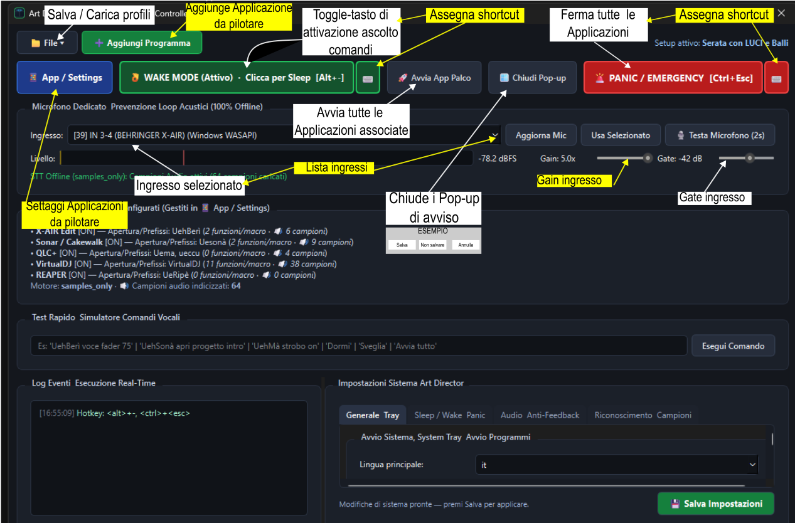

---

## ⚡ Punti di Forza Principali

- **🎙️ Voice-to-Command (100% Offline, Zero Cloud):** gestisci tutto lo show *parlando*, senza alcuna connessione internet, grazie al confronto rapido sui tuoi campioni vocali (**MFCC + DTW**, `< 30 ms`) e al fallback locale **Vosk** / **Faster-Whisper**.
  - **Esempio 1 — Mixer Digitali (Behringer XR18 / X-AIR / OSC):** *"Muta Monitor"*, *"Attiva Ducker"*, *"Alza Master Bus"*, *"Alza/abbassa send canale 2 su FX 1"*, *"Attiva compressore Ch 1"*, *"Attenua bassi su canale 11"* — e tutte le funzioni disponibili sulle superfici di controllo (`Gate`, `Comp`, `EQ`, `Sends`, `Main`, `FX`, `Snapshot`, `RTA`).
  - **Esempio 2 — Software & Hardware Luci (QLC+ / Art-Net DMX):** *"Vai con il chaser inseguimento"*, *"Fai buio"*, *"Attiva strobo su teste a sinistra"*, *"Dai fumo"*, *"Abbassa fader master al 60%"*, ecc.
- **🎯 Learn-and-Assign Vocale (`Picking` Visivo):** abbina la tua voce a qualsiasi fader, pulsante, knob, menu o marker semplicemente **cliccandoci sopra** nella finestra reale del programma bersaglio.
- **🌐 OSC Universale, MIDI & Art-Net DMX:** un'unica voce per governare mixer digitali, DAW (`Sonar / Cakewalk`, `REAPER`, ecc.), software e controller DJ (`VirtualDJ`), software e centraline luci (`QLC+`, DMX Art-Net), tastiere, expander e multieffetti (**MIDI CC, Note e Program Change con Bank Select MSB/LSB**).
- **⚡ Macro Vocali Simultanee:** un solo ordine vocale può attivare una sequenza combinata di comandi UDP (OSC/Art-Net), cambi patch MIDI, apertura sicura di progetti DAW (`{nome}`) e scorciatoie da tastiera alla velocità della luce.
- **🛡️ Sicurezza da Palco Anti-Falsi Comandi:** microfono dedicato con **filtro passa-alto e Noise Gate**, **Wake / Sleep Mode**, **Push-to-Talk (PTT)** da tastiera, **Auto-Sleep dopo inattività**, assegnazione diretta delle shortcut tramite **`⌨️`** su **Wake/Sleep** e **PANIC**, blocco Pop-up imprevisti e tasto **PANIC / EMERGENCY** immediato.
- **🎒 Pen Drive Portatile & Profili `.zip`:** tramite **`📁 File ▾`** salvi e ricarichi al volo configurazioni complete o parziali (`.json` / `.zip` con i `.wav` inclusi) per passare da un setup serale all'altro in un clic.

---

## 📸 Manuale Passo-Passo Visivo (12 Immagini)

### 1. Aggiungere un Programma da Dirigere (`+ Aggiungi Programma`)

| Step 1 — Premi **`+ Aggiungi Programma`** | Step 2 — Apri la lista programmi |
| :---: | :---: |
| 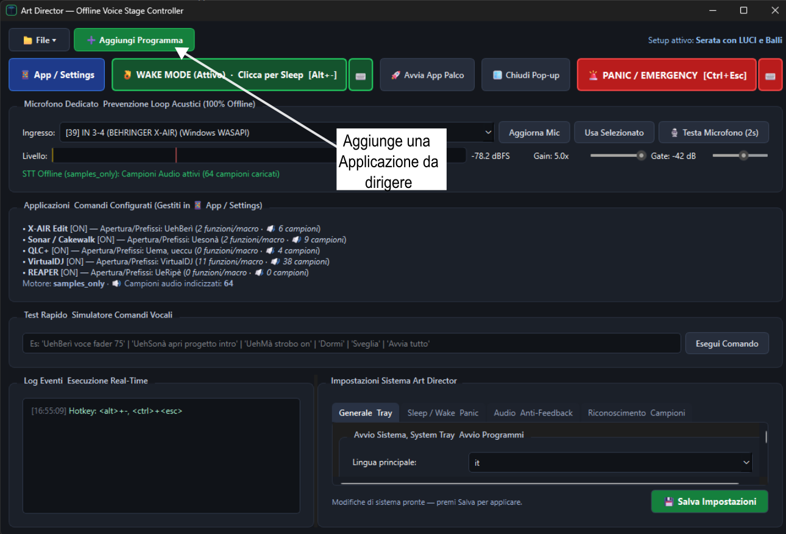 | 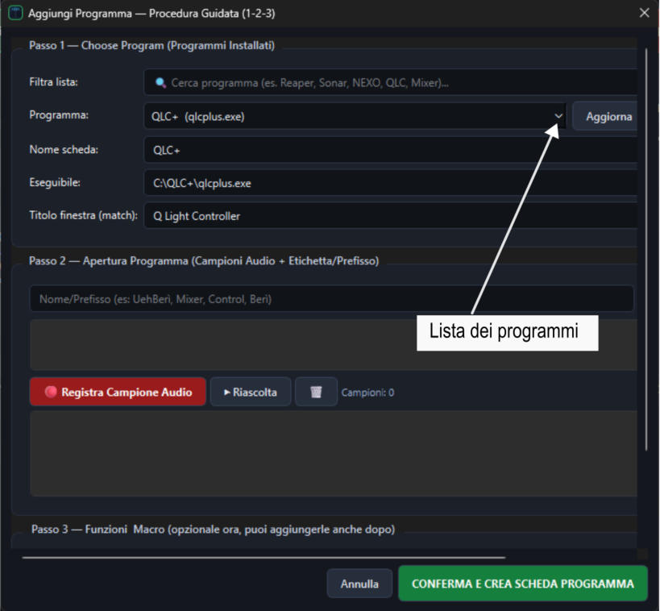 |

| Step 3 — Seleziona l'applicazione | Step 4 — Registra il comando d'apertura e conferma |
| :---: | :---: |
| 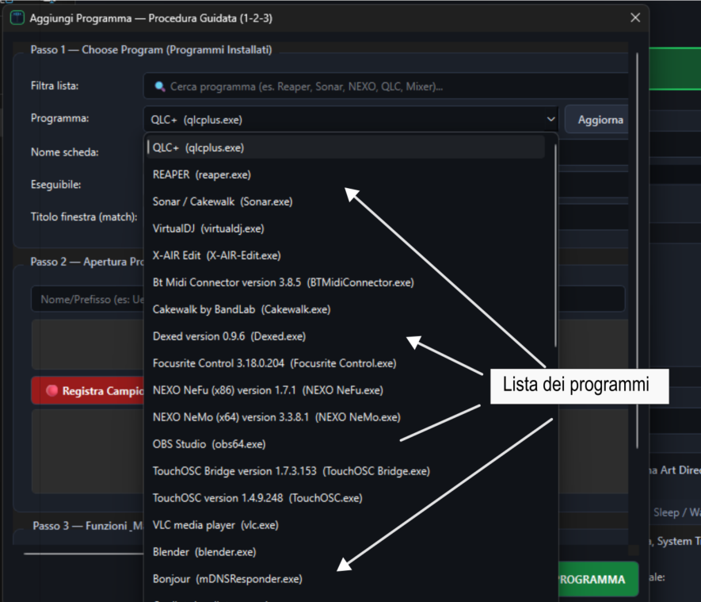 | 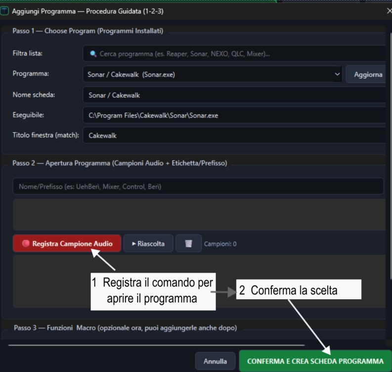 |

1. Dalla barra superiore premi il tasto verde **`+ Aggiungi Programma`**.
2. Apri la tendina **`Programma:`** (puoi filtrare in **`Filtra lista:`** o aggiornare con **`Aggiorna`**).
3. Scegli il software tra quelli rilevati automaticamente sul sistema (`QLC+`, `REAPER`, `Sonar / Cakewalk`, `VirtualDJ`, `X-AIR Edit`, `OBS`, `TouchOSC`, ecc.). *(Se usi un programma portatile potrai sfogliarne l'eseguibile nella sua scheda).*
4. Scrivi un prefisso breve (es. *`UehBeri`*, *`Uesonà`*, *`VirtualDJ`*), registra 2–3 campioni vocali con **`Registra Campione Audio`** per aprire/richiamare il programma e conferma con **`CONFERMA E CREA SCHEDA PROGRAMMA`**.

---

### 2. Associare Funzioni & Macro con il `Picking` Visivo (`App / Settings`)

| Step 5 — Entra in **`📱 App / Settings`** | Step 6 — Scegli la scheda del programma |
| :---: | :---: |
| 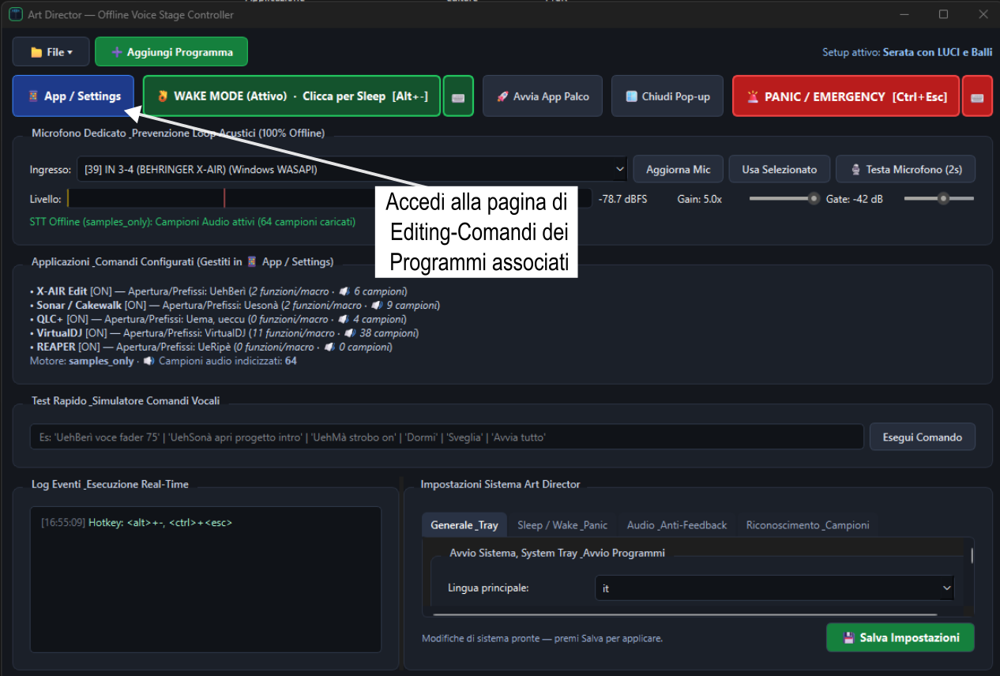 | 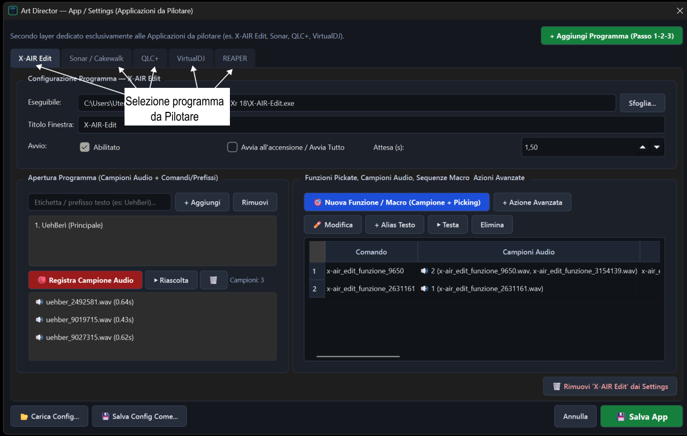 |

| Step 7 — Premi **`Nuova Funzione / Macro`** | Step 8 — Clicca direttamente sul controllo nell'app |
| :---: | :---: |
| 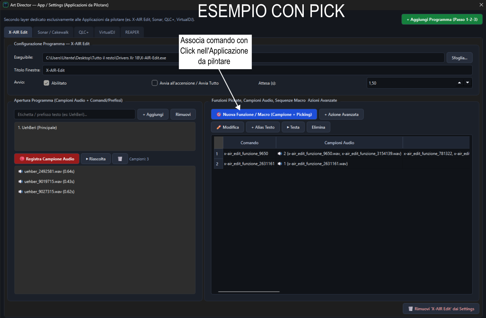 | 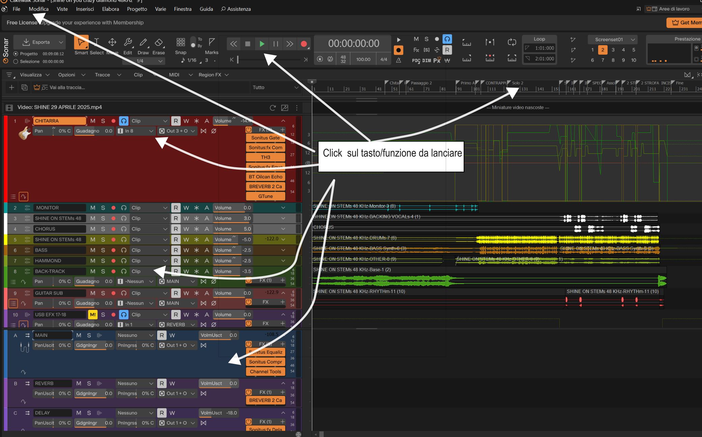 |

5. Clicca il pulsante blu **`📱 App / Settings`** per accedere al secondo layer dedicato esclusivamente alle applicazioni da pilotare.
6. Seleziona in alto la scheda del programma desiderato (`X-AIR Edit`, `Sonar / Cakewalk`, `QLC+`, `VirtualDJ`, `REAPER`…).
7. Premi **`Nuova Funzione / Macro (Campione + Picking)`**: nella colonna di sinistra registri il comando vocale, in quella di destra avvii il **`Picking`**.
8. Clicca (singolo, doppio clic, clic destro o rotella) direttamente sui tasti, menu, tracce, bus o marker nella finestra aperta del programma. Premi **`F9`** (o **`✅ Fine Picking`**) e **`CONFERMA`**.

---

### 3. Registra Alias, Salva App & Comandi **`+ Azione Avanzata`** (OSC / MIDI / Art-Net)

| Step 9 — Registra comandi/alias e premi **`Salva App`** | Step 10 — Menu completo **`+ Azione Avanzata`** |
| :---: | :---: |
| 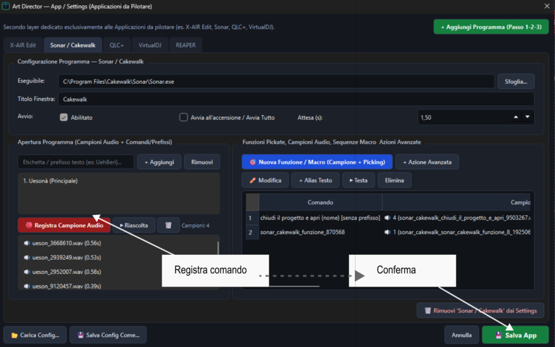 | 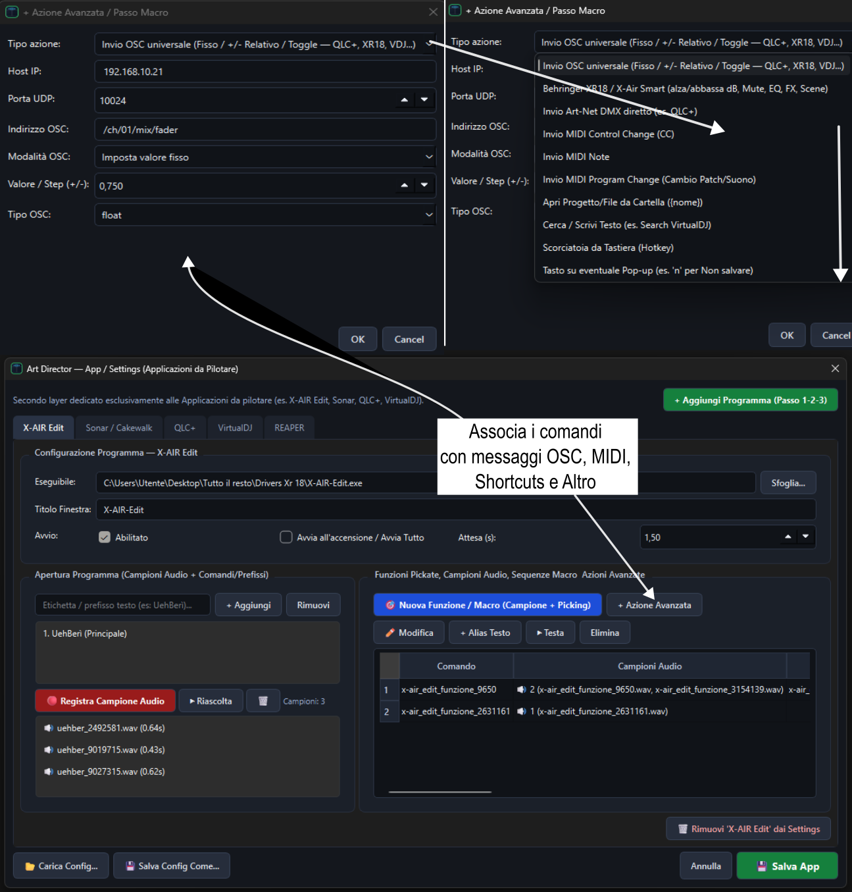 |

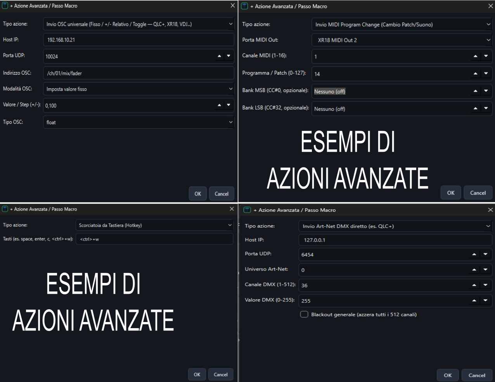

9. Nella colonna sinistra (**`Apertura Programma`**) puoi aggiungere in qualsiasi momento nuovi campioni vocali; in basso a destra premi **`💾 Salva App`** per salvare le modifiche.
10. Clicca **`+ Azione Avanzata`** (dalla scheda programma o dentro una macro) per inviare comandi diretti in background **senza muovere il mouse**:
    - **Invio OSC universale:** valore fisso (`set`), relativo `+/-` con **UDP Query** dal vivo dal mixer, o `toggle` (`Min <-> Max`).
    - **Behringer XR18 / X-Air Smart:** frasi naturali (*"alza canale 7"*, *"canale 1 phantom on"*, *"inverti fase canale 3"*) tradotte direttamente in messaggi OSC XR18 o navigazione X-AIR Edit.
    - **Invio Art-Net DMX diretto (`6454`):** Universo, Canale DMX (`1–512`), Valore (`0–255`) o **Blackout generale**.
    - **Invio MIDI (`CC`, `Note`, `Program Change`):** cambio patch/suoni su **tastiere, expander e multieffetti** (`Programma/Patch 0–127` + opzionali **Bank MSB `CC#0`** e **Bank LSB `CC#32`**).
    - **Apri Progetto/File (`{nome}`), Cerca/Scrivi Testo (VirtualDJ Search), Hotkey (`<ctrl>+w`), Tasto su Pop-up, Pausa (`ms`).**

---

## 🛡️ Controllo Serata, Shortcut & Configurazione Rapida

- **Assegnazione Diretta Shortcut (`⌨️`):** accanto a **`WAKE MODE`** e **`PANIC / EMERGENCY`** trovi il tastino **`⌨️`** (e menu con **click destro** su entrambi i bottoni). Premi **`⌨️`** e premi il tasto vero sulla tastiera (`Ctrl+Esc`, `Alt+-`, `Alt++`, `Pausa`, `F12`…) — le shortcut sono **globali** e funzionano anche mentre stai usando XR18, Cakewalk, QLC+ o VirtualDJ.
- **Push-to-Talk & Auto-Sleep (`Sleep / Wake & Panic`):** imposta un tasto **Push-to-Talk** (ascolta solo mentre lo tieni premuto) oppure l'**Auto-Sleep** dopo *N* secondi di inattività per evitare comandi involontari mentre canti o parli tra un brano e l'altro.
- **Anti-Feedback (`Audio & Anti-Feedback`):** imposta la soglia **Gate (dBFS)** appena sopra i rientri delle spie e tieni attivo il **Filtro Passa-Alto (`100 Hz`)**.
- **Motore Vocale Offline (`Riconoscimento & Campioni`):**
  - `samples_hybrid` *(predefinito)*: abbina prima i tuoi file `.wav` in `campioni/` (`< 30 ms`, perfetto per voce reale, dialetto e nomi propri) e passa a **Vosk** / **Faster-Whisper** solo per comandi variabili come `{nome}`.
  - `samples_only`: solo campioni registrati (massima reattività e zero falsi positivi).
- **Profili `.zip` & Pen Drive:** dal menu **`📁 File ▾`** salvi e ricarichi profili separati (`configurazioni/`). In modalità portatile (`portable.flag`) puoi portare tutto su una **Pen Drive USB** con `ArtDirector.exe`.

---

## 📋 Tabelle, Prontuari & Guide Passo-Passo (OSC, Mackie Control & MIDI)

Tutte le tabelle complete e le guide pratiche *"Se vuoi fare quello, fa' questo"* sono raccolte nella cartella **[Richiami comandi](Richiami%20comandi/README.md)**:

- **[Appendice A — Capire l'OSC Passo-Passo (*"Se vuoi fare quello, fa' questo"*)](Richiami%20comandi/Appendice_A_Capire_OSC.md)** — Cos'è l'OSC spiegato semplice (IP, Porta, Indirizzi, scala fader `0.75 = 0 dB`) + ricette pronte per mixer, luci e macro multi-azione.
- **[Appendice B — Capire Mackie Control (MCU) & MIDI per DAW, Tastiere e Multieffetti](Richiami%20comandi/Appendice_B_Mackie_Control_e_MIDI.md)** — Come usare `loopMIDI` e la tabella tasti Mackie Control (`Play`, `Stop`, `Rec`, `Mute/Solo` tracce), `MIDI CC` e `Program Change`.
- **[Behringer XR18 / X-AIR Edit v1.8.0 (OSC UDP 10024)](Richiami%20comandi/OSC_Behringer_XR18_XAir.md)** — Canali, Gain/+48V/Fase/USB, Gate, Compressor, EQ 4 & 6 Bande/HPF, Sends & Tap, Main LR, FX, DCA, Mute Groups, AutoMix, Scene, RTA, Tab UI.
- **[QLC+ Luci & VirtualDJ (OSC · Art-Net DMX · WebSocket · MIDI)](Richiami%20comandi/OSC_ArtNet_QLC_VirtualDJ.md)** — Blackout, Grand Master, Virtual Console `/vc/...`, Art-Net `6454`, Deck 1–2, Sidelist, Crossfader, EQ & Gain.
- **[OSC Universale, MIDI (`CC` / `Note` / `Program Change`) & Macro](Richiami%20comandi/OSC_MIDI_Universale.md)** — Guida pratica per tastiere, stage piano, multieffetti, DAW (`REAPER`, `Sonar`), OBS e TouchOSC.

---

### Opzione A — Versione Portatile Pronta (Windows Pen Drive, senza Python)
Scarica **`ArtDirector_v1.0_Windows_Portable.zip`** dalla pagina **[GitHub Releases](https://github.com/umbertorebus-FlaSta/ArtDirector/releases)**, estrai la cartella (su PC o su Pen Drive USB) e avvia **`ArtDirector.exe`**.  
Grazie a `portable.flag`, impostazioni, campioni `.wav` e modelli offline restano dentro la cartella stessa; se vuoi installarlo su PC con icone su Desktop e Menu Start esegui **`Installa_ArtDirector.bat`**.

### Opzione B — Avvio da Sorgente Python (Windows / macOS / Linux, Python ≥ 3.10)

```powershell
# Clona e installa dipendenze (Python >= 3.10)
git clone https://github.com/umbertorebus-FlaSta/ArtDirector.git
cd ArtDirector
python -m venv .venv
.\.venv\Scripts\python.exe -m pip install -r requirements.txt

# Avvia ArtDirector
.\.venv\Scripts\python.exe run_art_director.py

# Avvio silenzioso nella System Tray
.\.venv\Scripts\python.exe run_art_director.py --background

# Compila pacchetto portatile per Pen Drive (ArtDirector_PenDrive/)
.\.venv\Scripts\python.exe build\build_package.py

# Test automatici core (non-GUI)
.\.venv\Scripts\python.exe -m pytest tests\test_config.py tests\test_dsp_and_state.py tests\test_parser.py tests\test_targets_xr18.py tests\test_controller_e2e.py -k "not gui" -v
```

> 📦 Per pubblicare o aggiornare questo repository e la prima Release su GitHub, segui la guida rapida in **[docs/GITHUB_SETUP_IT.md](docs/GITHUB_SETUP_IT.md)**.

## 📄 Licenza

Distribuito sotto licenza **[Apache License 2.0](LICENSE)** (`Copyright 2026 umbertorebus-FlaSta`).
