# 🎙️ ArtDirector — 100% Offline Voice Controller for Stage & Studio

**[🇬🇧 English](README.md)** · **[🇮🇹 Italiano](README.it.md)** · **[📡 OSC / MIDI / Art-Net Reference](docs/OSC_MIDI_REFERENCE.md)** · **[📋 Command Cheat Sheets (IT)](Richiami%20comandi/README.md)**

> **The hands-free, zero-cloud voice controller that turns your spoken commands into Universal OSC, MIDI, Art-Net DMX, and Visual GUI Macros for live shows and studio production.**

Designed by and for **musicians, FOH/monitor sound engineers, DJs, lighting designers, and studio producers**, **ArtDirector** follows one practical philosophy: **eliminate hands-on-mouse/fader interruptions during performance** while keeping **100% offline reliability and zero-cloud latency** on stage.

No coding required, no endless manual mappings:
**Pick a control or choose a protocol (`OSC` / `MIDI` / `Art-Net`) ➔ Record your own voice sample ➔ Command assigned!**

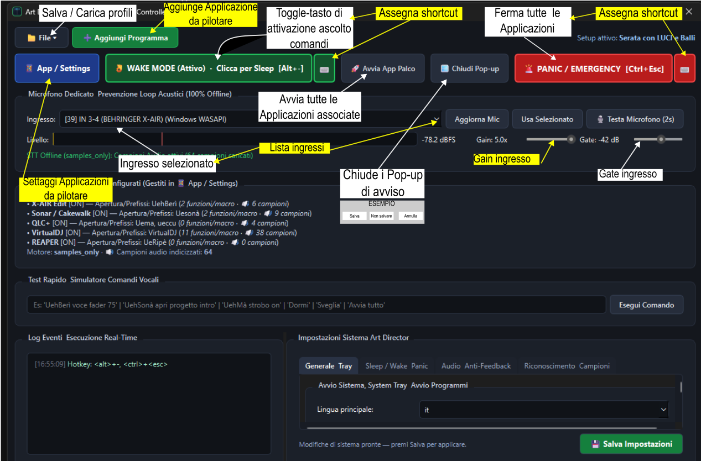

---

## ⚡ Key Features

- **🎙️ Voice-to-Command (100% Offline, Ultra-Low Latency):** Control your entire show simply by talking — works completely without internet via local voice-sample matching (**MFCC + DTW**, `< 30 ms`) and optional local **Vosk** / **Faster-Whisper** fallback.
  - **Example 1 — Digital Mixers (Behringer XR18 / X-AIR / OSC Mixers):** *"Mute monitor"*, *"Enable ducker"*, *"Raise bus master"*, *"Send channel 2 to FX 1 up/down"*, *"Enable Ch 1 compressor"*, *"Cut lows on channel 11"* — plus EQ, HPF, Gate, Sidechain KeySrc, Tap points, AutoMix, DCA, Mute Groups, Snapshots, and RTA.
  - **Example 2 — Lighting Software & Hardware (QLC+ / Art-Net DMX):** *"Start chase sequence"*, *"Blackout"*, *"Strobe on moving heads left"*, *"Trigger fog"*, *"Dim Grand Master to 60%"*.
- **🎯 Visual Learn-and-Assign (`Picking`):** Click any button, menu, fader, track, or timeline marker directly inside the target application window to capture single actions or multi-step macros without writing code.
- **🌐 Universal OSC, MIDI & Art-Net DMX:** Govern mixers, DAWs (`Sonar / Cakewalk`, `REAPER`, etc.), DJ decks (`VirtualDJ`), lighting consoles (`QLC+`), hardware keyboards/synths, and guitar/vocal multi-FX units (**MIDI CC, Note, and Program Change + Bank Select MSB/LSB**).
- **⚡ Simultaneous Multi-Protocol Voice Macros:** A single spoken phrase can trigger an instant chain of UDP network packets (OSC / Art-Net), MIDI patch changes, safe project switching (`{nome}`), and GUI actions.
- **🛡️ Live Stage Safety (Zero Accidental Triggers):** Dedicated microphone input with HPF & live Noise Gate, **Wake / Sleep Mode**, **Push-to-Talk (PTT)** hold key, **Auto-Sleep timeout**, direct **`⌨️`** shortcut assignment right on the **Wake/Sleep** & **PANIC** buttons, popup/error-dialog guard, and instant **PANIC / EMERGENCY** global reset.
- **🎒 Portable Pen-Drive Ready & `.zip` Setup Profiles:** Export or load stage setups (`.json` or self-contained `.zip` with voice `.wav` samples) in one click via **`📁 File ▾`**, or carry the standalone executable on a USB flash drive.

---

## 📸 Visual Step-by-Step Guide (12 Screenshots)

> **Note:** Interface screenshots show the built-in Italian labels alongside universal audio/OSC/MIDI concepts; English captions below explain every step. Setting `language: en` is supported in **Generale & Tray**.

### 1. Adding Any Application to Control (`+ Aggiungi Programma`)

| Step 1 — Click **`+ Aggiungi Programma`** | Step 2 — Open the Detected Programs List |
| :---: | :---: |
| 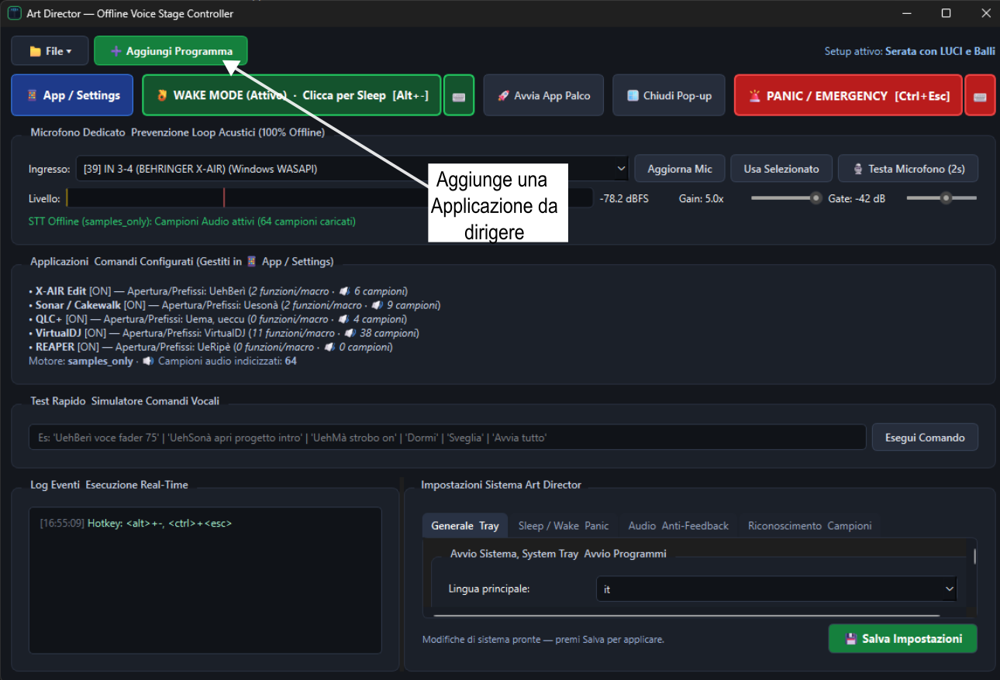 | 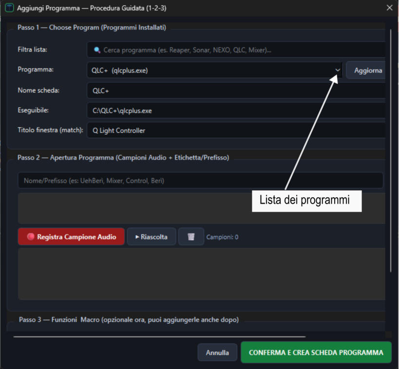 |

| Step 3 — Choose Your Software | Step 4 — Record Opening Command & Confirm |
| :---: | :---: |
| 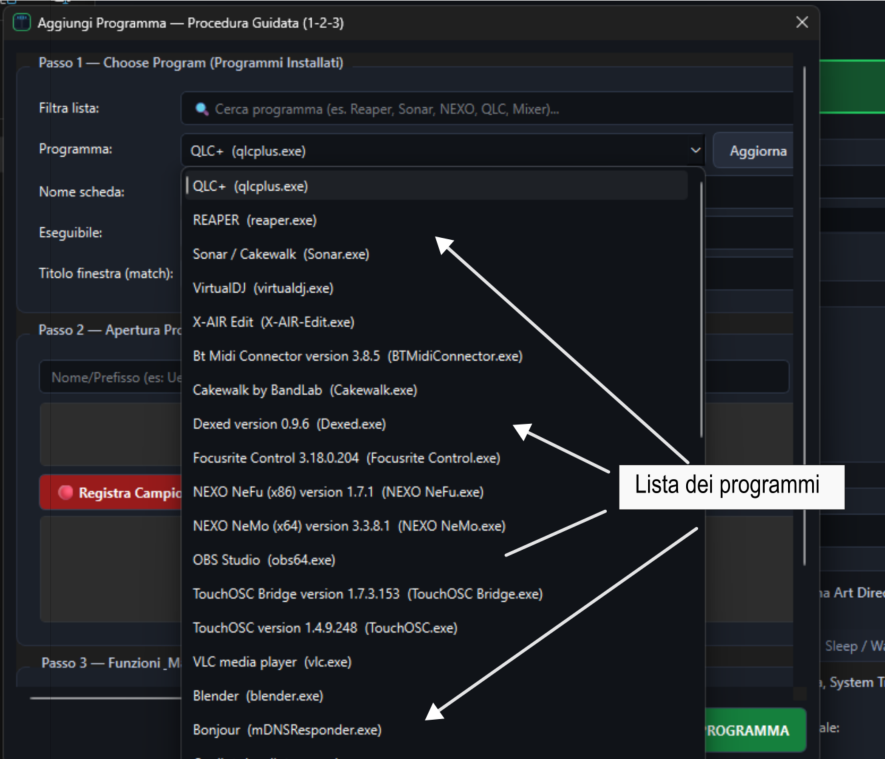 | 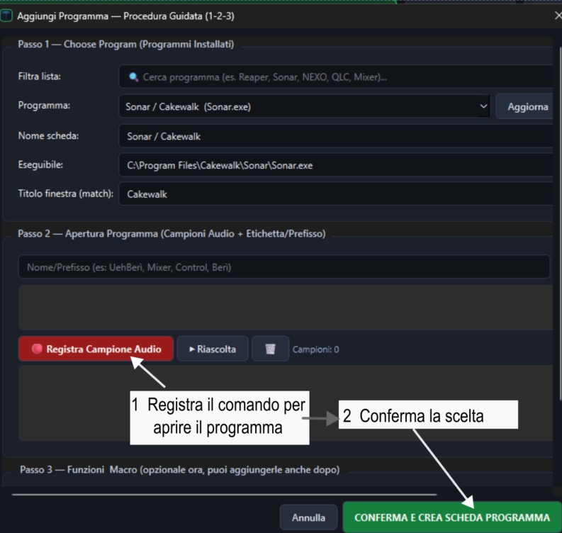 |

1. Click **`+ Aggiungi Programma`** (top-left green button).
2. Open **`Programma:`** (use **`Filtra lista:`** or **`Aggiorna`**) — ArtDirector scans installed music, lighting, DJ, and studio apps automatically (you can also browse any `.exe`/binary manually later).
3. Select your software: tab name, executable path, and window title matching are filled in automatically.
4. Type a short voice prefix/label (e.g. *`Mixer`*, *`Lights`*, *`Sonar`*), click **`Registra Campione Audio`** to record 2–3 natural takes of the open/focus command, and click **`CONFERMA E CREA SCHEDA PROGRAMMA`**.

---

### 2. Visual Control Mapping with `Picking` (`App / Settings`)

| Step 5 — Open **`📱 App / Settings`** | Step 6 — Select the Program Tab |
| :---: | :---: |
| 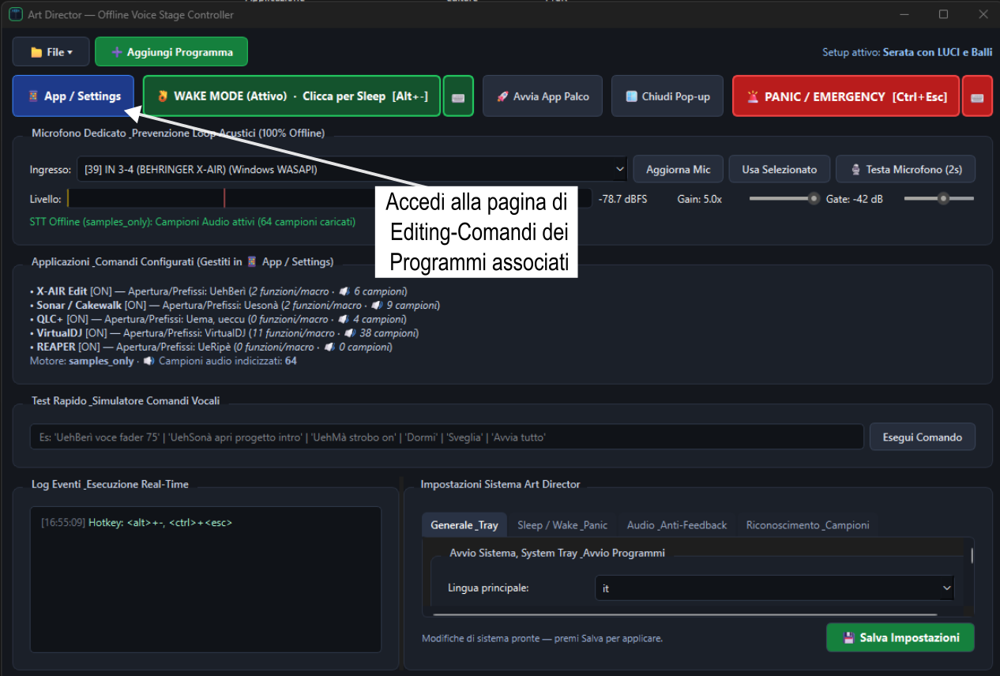 | 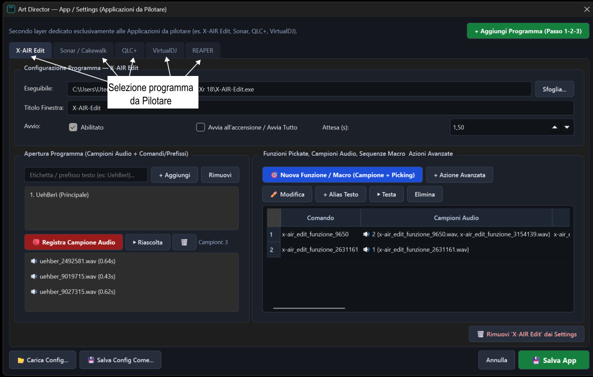 |

| Step 7 — Click **`Nuova Funzione / Macro`** | Step 8 — Pick Controls Live in Your App Window |
| :---: | :---: |
| 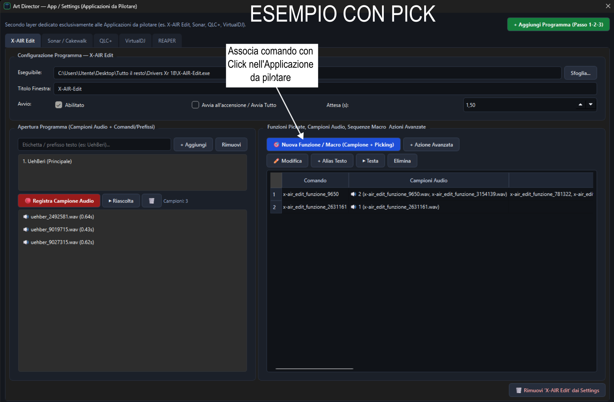 | 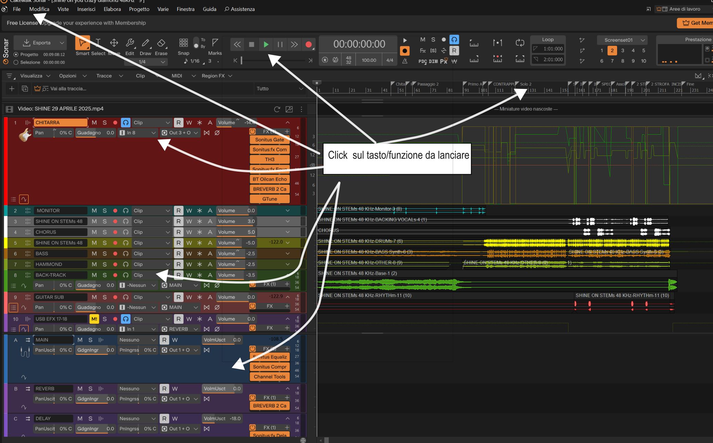 |

5. Click **`📱 App / Settings`** on the main toolbar to open the second layer dedicated strictly to your controlled applications.
6. Select the tab of the software you want to configure (`X-AIR Edit`, `Sonar / Cakewalk`, `QLC+`, `VirtualDJ`, `REAPER`, etc.).
7. Click **`Nuova Funzione / Macro (Campione + Picking)`**, record your spoken phrase on the left, then start **Picking** on the right.
8. Click directly on any button, menu, track control, bus, or marker inside your open application (multi-click sequences form an ordered macro). Press **`F9`** (or **`Fine Picking`**) and confirm.

### 3. Saving Voice Aliases & Adding Protocol Actions (`+ Azione Avanzata`)

| Step 9 — Record Aliases & Save App | Step 10 — Add Direct OSC / MIDI / Art-Net Actions |
| :---: | :---: |
| 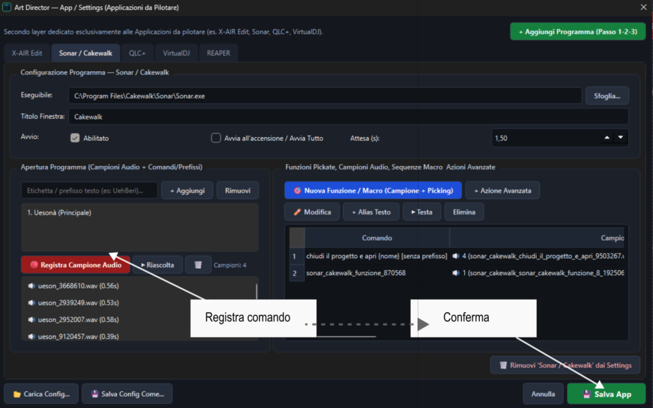 | 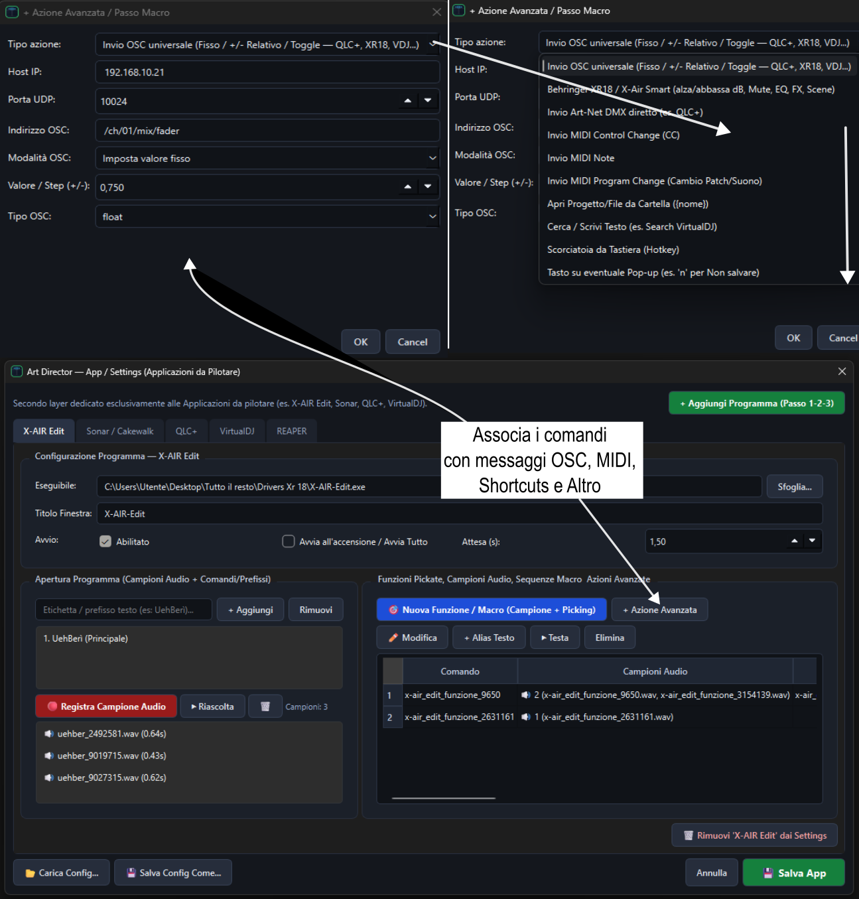 |

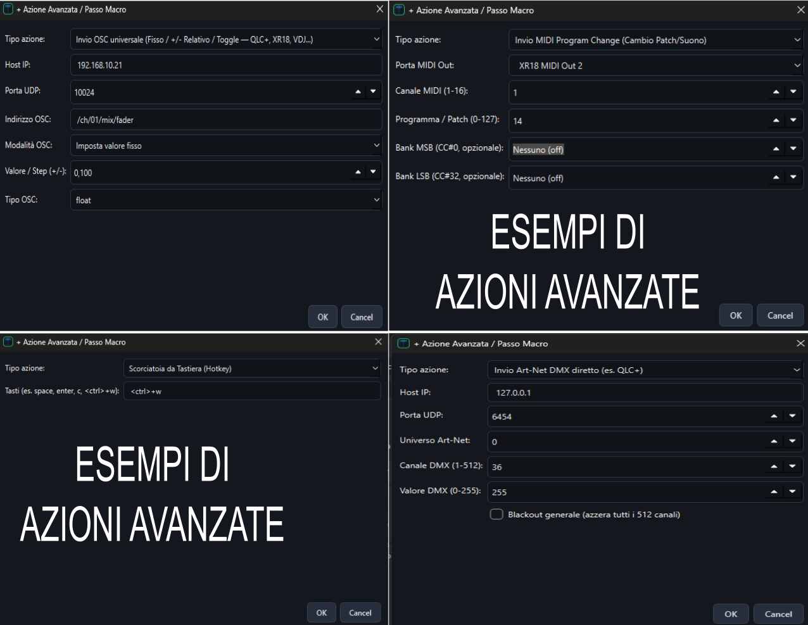

9. You can always record extra voice samples/aliases on the left (**`Apertura Programma`**) or test functions on the right with **`► Testa`**, then click green **`Salva App`**.
10. Click **`+ Azione Avanzata`** (either from the program tab or inside any macro) to add direct background protocol actions without touching the mouse/GUI:
    - **Universal OSC (`float`/`int`):** fixed `set`, relative `+/-` with live **UDP Query**, or `toggle` (`Min <-> Max`).
    - **Behringer XR18 / X-AIR Smart:** natural commands (`"raise ch 7"`, `"ch 1 phantom on"`, etc.) converted automatically into XR18 OSC / X-AIR Edit shortcuts.
    - **Art-Net DMX Direct (UDP `6454`):** direct Universe / DMX channel (`1–512`) / value (`0–255`) or full 512-channel Blackout.
    - **MIDI Out (`CC`, `Note`, `Program Change`):** patch switching for keyboards, synths, and multi-FX processors with optional **Bank MSB (`CC#0`)** & **Bank LSB (`CC#32`)**.
    - **DAW Project Opening (`{nome}`), Text Paste/Search, Hotkey (`<ctrl>+w`), Popup Key (`hotkey_if_dialog`), and Wait (`ms`).**

---

## 🛡️ Stage Safety, Shortcuts & Offline Speech Setup

- **Direct Shortcut Assignment (`⌨️`):** Right next to **`WAKE MODE / SLEEP`** and **`PANIC / EMERGENCY`** (or via right-click on either button), click **`⌨️`** to press any real key combination (`Alt+-`, `Ctrl+Esc`, `F12`, `Pause`, `ScrollLock`…) — global hotkeys keep listening even while your mixer, DAW, DJ, or lighting window is in focus.
- **Push-to-Talk & Auto-Sleep:** In **`Sleep / Wake & Panic`**, bind a **Push-to-Talk** hold key (mic opens *only* while held down) and/or an **Auto-Sleep** inactivity timer (`seconds`) so stray stage speech or singing never triggers commands.
- **Acoustic Anti-Feedback:** Set **`Gate (dBFS)`** just above stage monitor bleed on the live level meter and enable the **`100 Hz` High-Pass Filter** in **`Audio & Anti-Feedback`**.
- **Voice Engines (`Riconoscimento & Campioni`):**
  - `samples_hybrid` *(default)*: compares incoming voice against your local `.wav` recordings in `campioni/` first (`< 30 ms`, works in any language, dialect, or nickname), falling back to local **Vosk** or **Faster-Whisper** for open-ended text/variables like `{nome}`.
  - `samples_only`: ultra-fast matching exclusively against your recorded samples.
- **Setup Profiles (`📁 File ▾`):** Save and swap full or app-subset `.json` presets or portable `.zip` bundles (including linked `.wav` files) inside `configurazioni/`.

---

## 🚀 Installation & Running from Source

### Option A — Portable Executable (Windows Pen Drive)
Download `ArtDirector_v1.0_Windows_Portable.zip` from the **[GitHub Releases](https://github.com/umbertorebus-FlaSta/ArtDirector/releases)** page (or build `ArtDirector.exe` locally). Keep `portable.flag` beside the `.exe` for USB stick operation so `config.json`, `campioni/`, `configurazioni/`, and `models/` stay portable.  
To install locally with Start Menu / Desktop shortcuts, run `Installa_ArtDirector.bat` (`ArtDirector.exe --install`) or use **Generale & Tray → Installa su PC**.

### Option B — Python Source (Windows / macOS / Linux, Python ≥ 3.10)

```bash
git clone https://github.com/umbertorebus-FlaSta/ArtDirector.git
cd ArtDirector

python -m venv .venv
# Windows: .venv\Scripts\activate
# macOS / Linux: source .venv/bin/activate
pip install -r requirements.txt

# Launch GUI
python run_art_director.py

# Launch silently in System Tray
python run_art_director.py --background
```

### Build Standalone Package (PyInstaller)

```bash
python build/build_package.py
```

---

## 🏗️ Modular Architecture

```text
art_director/
├── config/          # Typed AppConfig schema, atomic config.json saves, portable .zip export/import
├── core/            # EventBus, StateManager (👍/👋/🚨), CommandRouter, ProgramExecutor, StageAppLauncher, Controller
├── audio/           # Dedicated input device selection, anti-rumble HPF, Noise-Gate VAD, live VU metering
├── stt/             # 100% offline engines (MFCC+DTW SampleLibrary, Vosk streaming, Faster-Whisper local)
├── os_layer/        # Cross-platform OS bridge (Windows Win32, macOS AppleScript, Linux wmctrl), Picker & Global Hotkeys
├── targets/         # Behringer XR18 (OSC 10024), Cakewalk/DAW, QLC+ (OSC/Art-Net/WS/.qxw), VirtualDJ, Popup Guard
└── ui/              # Dual-layer dark PySide6 stage UI, Wizard (Step 1-2-3), 2-col Pick/Macro Editor, Hotkey Capture, System Tray
```

## 📚 OSC, Art-Net DMX & MIDI Command Reference

- **[Appendix A — Understanding OSC Step-by-Step ("If you want X, do this")](docs/APPENDIX_A_OSC_GUIDE.md)** — Beginner-friendly cookbook explaining IP/Port/Addresses/Fader scale (`0.75 = 0 dB`) with ready-to-copy recipes.
- **[Appendix B — Mackie Control (MCU) & MIDI for DAWs, Keyboards & Multi-FX](docs/APPENDIX_B_MACKIE_CONTROL.md)** — How to drive Cakewalk/Sonar, REAPER, Cubase, hardware synths, and multi-FX via `loopMIDI`, MCU Notes, `MIDI CC`, and `Program Change`.
- **[Complete Technical Reference (English)](docs/OSC_MIDI_REFERENCE.md)** — Verified OSC paths, dB/frequency curves, Behringer XR18 (`Gate`, `Comp`, `EQ 4/6-band`, `Sends`, `Main LR`, `FX`, `DCA`, `Mute Groups`, `AutoMix`, `Snapshot`, `RTA`, `X-AIR-Edit` v1.8.0 navigation), QLC+ (`OSC / Art-Net / WebSocket`), VirtualDJ, Universal OSC, and MIDI `CC` / `Note` / `Program Change`.
- **[Prontuari & Tabelle Comandi (Italiano)](Richiami%20comandi/README.md)** — Schede rapide e Appendici in Italiano.

## 🧪 Automated Tests (Non-GUI Core Suite)

```bash
pytest tests/test_config.py tests/test_dsp_and_state.py tests/test_parser.py tests/test_targets_xr18.py tests/test_controller_e2e.py -k "not gui" -v
```

## 📄 License

Released under the **[Apache License 2.0](LICENSE)** (`Copyright 2026 umbertorebus-FlaSta`).
